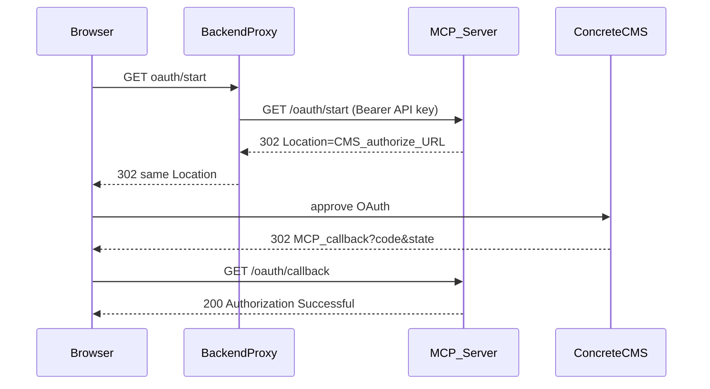

# Developer guide: authorize the users from your application

This page explains how an application can start the Concrete CMS sign-in for its users, without giving them the key of the connector (a technique known as proxied OAuth).
It is for developers: to authorize the users by hand, see [Authorize the users](remote-server.md#authorize-the-users).

Most HTTP clients — including Concrete CMS packages, web app backends, and agent services — should **not** send the browser directly to MCP `/oauth/start`. The API key stays server-side; the backend proxies the start request.

1. **Backend** calls `GET /oauth/start?user_id=N` with `Authorization: Bearer <MCP_API_KEY>`.
2. MCP returns **`302`** with `Location:` pointing to the CMS authorize URL. The URL includes **`state=`**, **`code_challenge=`**, `client_id`, and `redirect_uri`.
3. Backend redirects the **browser** to that `Location` URL **unchanged** (do not rebuild or strip query parameters).
4. User approves on Concrete CMS. CMS redirects to `{PUBLIC_BASE_URL}/oauth/callback?code=...&state=...`.
5. Browser hits the MCP callback. MCP resolves the pending PKCE session (by callback `state` when echoed, otherwise by trying each pending session until PKCE verification succeeds — Concrete CMS currently **replaces** `state` on callback rather than echoing the value from step 2) and exchanges the code.

The browser does **not** need an MCP-host cookie. Session binding uses PKCE plus an in-memory pending session, not `Set-Cookie`.

> **Concrete CMS `state` behavior:** The authorize URL from `/oauth/start` includes MCP-generated `state`, but Concrete CMS may issue a **different** `state` on callback. The MCP server handles this by matching the authorization code to the correct pending session through PKCE verification. Concurrent OAuth flows remain safe because only the session whose `code_verifier` matches the issued code can complete token exchange.

> **Important:** `npm run start` runs `dist/index.js`. After editing `src/`, run `npm run build` (or rely on the `prestart` hook) so `dist/` matches `src/`. A stale `dist/` build that omits `state` from authorize URLs will cause callback **400 Invalid or expired OAuth session** for proxied clients.

See the **[Developer guide](mcp-client-guide.md)** for web application and CMS package patterns.
